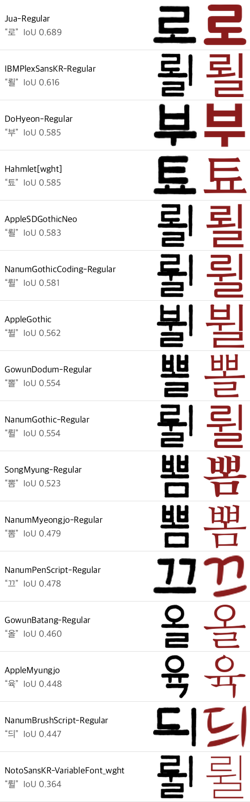
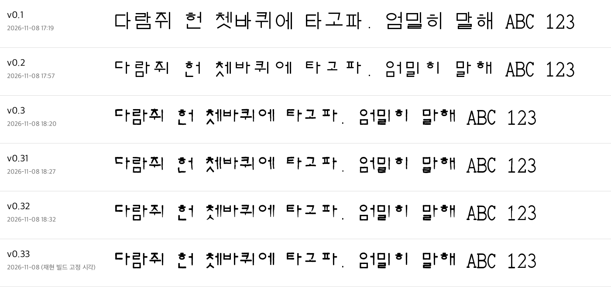

# 원본 증명 (PROVENANCE)

냄쿵타자기가 다른 글꼴을 베끼거나 변환하지 않고 처음부터 만든 글꼴이라는 증거를 모았다. 누구나 아래 방법으로 직접 확인할 수 있다.

| 증거 | 확인하는 것 | 확인 방법 |
|---|---|---|
| 1. 재현 빌드 | 배포한 글꼴 파일이 공개한 코드에서만 나온다 | 코드를 돌려 `SHA256SUMS` 와 비교, GitHub Actions 기록 |
| 2. 모양 비교 | 기존 한글 글꼴과 글자 모양이 겹치지 않는다 | `source/compare_fonts.py`, `provenance/similarity.json` |
| 3. 만든 과정 | 0.1 부터 0.33 까지 고쳐 온 과정이 남아 있다 | `provenance/history.png`, 아래 판별 기록 |

## 1. 재현 빌드 — 코드에서 같은 파일이 나온다

○ 글꼴 파일은 코드의 결과물이다

`source/build_font.py` 는 다른 글꼴 파일을 하나도 읽지 않는다. 글자마다 획이 지나가는 중심선 좌표가 코드에 적혀 있고, 이 선에 굵기를 입혀 윤곽을 만든다. 한글은 초성·중성·종성 부품을 한 벌씩 그린 뒤 11,172 음절을 부품 조합으로 만든다. 위치·굵기의 흔들림도 글자 이름에서 계산한 고정값(SHA-256)이라 실행할 때마다 같다.

글꼴 안에 들어가는 만든 시각도 2026-11-08 00:00 UTC 로 고정했다. 그래서 같은 코드와 같은 `fontTools` 판으로 만들면 배포 파일과 바이트 하나까지 같은 파일이 나온다. 다른 글꼴의 윤곽을 가져다 쓴 글꼴이라면 코드만으로 같은 파일을 만들어 낼 수 없다.

○ 직접 확인하는 방법

```
pip install -r source/requirements-build.txt
python source/build_font.py
python source/build_font.py --clean
python source/build_font.py --bold
cd source/build && shasum -a 256 -c ../../SHA256SUMS
```

세 줄 모두 `OK` 가 나오면 배포 파일과 같다.

○ GitHub 가 올릴 때마다 확인한다

`.github/workflows/reproduce.yml` 이 저장소에 변경이 올라올 때마다 macOS·Linux 에서 글꼴을 다시 만들어 `fonts/` 의 파일과 비교한다. 결과는 저장소의 Actions 탭에 남고, 이 기록은 GitHub 가 남기는 것이라 만든 쪽이 고칠 수 없다.

| 파일 | SHA-256 |
|---|---|
| `NaemkungTypewriter-Regular.ttf` | `f0907a953584ce1c244b5c4ee380ddebe231f8d030ebb3ed7d1a945d38089a96` |
| `NaemkungTypewriter-Clean.ttf` | `f9d67ca909338b792473a37817c777163beee551e2e23608d919bd8bc6df9379` |
| `NaemkungTypewriter-Bold.ttf` | `1e2d191ad37237a2b1659ca1ad8d5c5ba49caa005551b8868a5aef73c92d7154` |

## 2. 모양 비교 — 기존 한글 글꼴과 겹치지 않는다

○ 비교 방법

자주 쓰는 한글 2,350자(KS X 1001)와 영문·숫자 62자, 모두 2,412자를 비교했다. 글자마다 두 글꼴을 같은 크기로 그리고, 잉크가 묻은 영역을 64×64 칸에 맞춰 겹친다. 겹친 칸 수를 두 글자 중 하나라도 잉크가 있는 칸 수로 나눈 값(IoU)을 잰다. 같은 윤곽을 옮겨 쓰면 1 에 가깝고, 전혀 다른 모양이면 0 에 가깝다.

방법이 베낀 글꼴을 제대로 잡아내는지 보려고 냄쿵타자기 세 판끼리도 같은 방법으로 쟀다. 세 판은 같은 중심선에서 흔들림과 굵기만 달리 만든 것이라, 베낀 글꼴이 나올 수 있는 값의 기준이 된다.

○ 결과

| 비교 대상 | 한글 평균 | 한글 최고 | 0.8 이상 글자 수 |
|---|---|---|---|
| **기준선: 냄쿵타자기 Clean** | **0.851** | **0.960** | **2,084** |
| **기준선: 냄쿵타자기 Bold** | **0.770** | **0.942** | **510** |
| Jua | 0.374 | 0.689 | 0 |
| Do Hyeon | 0.355 | 0.585 | 0 |
| IBM Plex Sans KR | 0.295 | 0.616 | 0 |
| Apple SD Gothic Neo | 0.292 | 0.583 | 0 |
| Nanum Gothic Coding | 0.287 | 0.581 | 0 |
| Nanum Gothic | 0.282 | 0.554 | 0 |
| Hahmlet | 0.281 | 0.585 | 0 |
| AppleGothic | 0.268 | 0.562 | 0 |
| Gowun Dodum | 0.253 | 0.554 | 0 |
| Song Myung | 0.249 | 0.523 | 0 |
| Nanum Myeongjo | 0.209 | 0.479 | 0 |
| Gowun Batang | 0.206 | 0.460 | 0 |
| Nanum Pen Script | 0.203 | 0.478 | 0 |
| AppleMyungjo | 0.192 | 0.448 | 0 |
| Noto Sans KR | 0.176 | 0.364 | 0 |
| Nanum Brush Script | 0.166 | 0.447 | 0 |

기존 글꼴 16종 모두 0.8 을 넘는 글자가 한 자도 없다. 한글 평균은 0.17~0.37 로 기준선(0.77~0.85)과 크게 떨어져 있다. 영문까지 넣어도 가장 높은 값은 0.753(Nanum Gothic Coding 의 `V`)이고, 이는 획 두 개로 된 단순한 글자라 어느 글꼴이든 비슷하게 나오는 경우다.

글꼴마다 가장 닮게 나온 한글을 나란히 그렸다. 가장 닮은 글자도 획 모양과 비례가 다르다.



전체 결과(글꼴별 상위 12자 포함)는 `provenance/similarity.json`, 영문 포함 비교 그림은 `provenance/most_similar_pairs.png` 에 있다.

○ 직접 확인하는 방법

비교에 쓴 글꼴은 [Google Fonts 저장소](https://github.com/google/fonts/tree/main/ofl)의 OFL 글꼴 12종(Do Hyeon, Gowun Batang, Gowun Dodum, Hahmlet, IBM Plex Sans KR, Jua, Nanum Brush Script, Nanum Gothic, Nanum Gothic Coding, Nanum Myeongjo, Nanum Pen Script, Song Myung)과 macOS 기본 글꼴 3종(Apple SD Gothic Neo, AppleGothic, AppleMyungjo), Noto Sans KR 이다. 비교할 글꼴 파일을 받아 아래처럼 돌린다. 다른 글꼴과도 같은 방법으로 비교할 수 있다.

```
pip install -r source/requirements-compare.txt
python source/compare_fonts.py --ours fonts/NaemkungTypewriter-Regular.ttf \
  --calib fonts/NaemkungTypewriter-Clean.ttf fonts/NaemkungTypewriter-Bold.ttf \
  --refs <비교할 글꼴 파일들> --out provenance
```

○ 한계

모양 비교는 위 16종에 대해서만 했다. 판매 중인 상용 글꼴은 파일을 구할 수 없어 넣지 못했다. 특정 글꼴과 닮았다는 의견이 있으면 GitHub Issues 로 알려 주기 바란다. 같은 방법으로 비교해 결과를 이 문서에 더한다.

## 3. 만든 과정 — 0.1 부터 0.33 까지

○ 판별 기록

같은 문장을 판마다 찍은 그림이다. 시각은 각 판 글꼴 파일 안에 기록된 만든 시각(한국 시간)이다. 0.1 의 반듯한 네모꼴에서 시작해 옛 타자기 출력물의 배치 원리를 따라 탈네모꼴로 바꾸고, 획 모양을 여러 번 고친 과정이 남아 있다.



| 판 | 만든 시각(KST) | 바꾼 것 | 글꼴 파일 SHA-256 |
|---|---|---|---|
| 0.1 | 2026-11-08 17:19 | 획 중심선 생성기 첫 판, 네모꼴 | `3c7e9d03b46d2fcae59bc2ab5a0e6c4edc7dbd507219e68faf84cb9252abf670` |
| 0.2 | 2026-11-08 17:57 | 윗선 맞춤·아랫선 들쭉날쭉한 탈네모꼴로 다시 설계 | `531c47b6e42ca8ebf921145cbb5c35b2733541298068d0d3f3b7afbb0aee8c88` |
| 0.3 | 2026-11-08 18:20 | 획 굵기 차이, 둥근 잉크 끝, 거친 가장자리 | `4fc76ab4af6e09cd5c7dc988e12e5e30df22a5ba2bd27480bfe958659b9ed023` |
| 0.31 | 2026-11-08 18:27 | 중심선 흐트러뜨림 시험(0.32 에서 되돌림) | `f96146064f389810d8e8c4313656baeb636d4e4dfc0034cb1e6361eb8709cd52` |
| 0.32 | 2026-11-08 18:32 | 기울기 제거, 획 머리·끝 모양으로 손맛 | `0111901f30bc22b1c84aa13458de4ad7e6f3b48dbdea65c3b3352ea98e58ec86` |
| 0.33 | 2026-11-08 | 내림획 끝 가늘기 조정, 이름 확정, Bold 추가, 첫 공개 | 위 1절 표 |

0.1~0.32 는 작업 이름(RoomType 1984)으로 만든 시안이라 공개하지 않았다. 파일은 그대로 보관하고 있고, 위 SHA-256 값으로 보관본이 이 기록과 같은 파일임을 확인할 수 있다.

○ 참고한 것

1950~70년대 세벌식 수동 타자기 출력물 사진에서 윗선을 맞추고 아랫선을 들쭉날쭉하게 두는 배치 원리만 참고했다. 사진의 글자를 따라 그리거나 좌표를 옮기지 않았고, 사진은 저장소에 넣지 않았다. 지금 판매·배포 중인 탈네모꼴 글꼴은 참고하지 않았다.

---

## Provenance (English)

- **Reproducible build.** `source/build_font.py` reads no font files; every glyph is generated from stroke centerlines written in the code. Build timestamps are fixed, so the three fonts can be rebuilt byte-for-byte (`SHA256SUMS`). The `reproduce` GitHub Actions workflow rebuilds them on macOS and Linux on every push and compares them with `fonts/`.
- **Shape comparison.** 2,412 glyphs (KS X 1001 Hangul + Latin letters and digits) were compared with 16 Korean fonts using bitmap IoU. Our own Clean/Bold variants score a Hangul mean of 0.77–0.85, while all 16 other fonts score 0.17–0.37, and none has a single glyph at IoU ≥ 0.8. See `provenance/similarity.json` and `source/compare_fonts.py`.
- **Development history.** Drafts 0.1–0.32 with embedded build times and SHA-256 hashes are listed above (`provenance/history.png`). The drafts are archived privately and can be produced on request.
