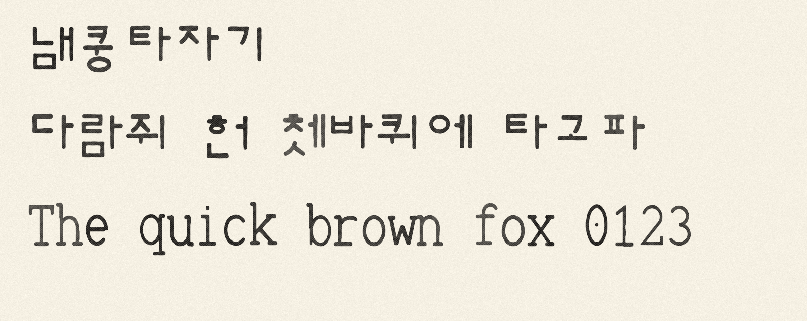
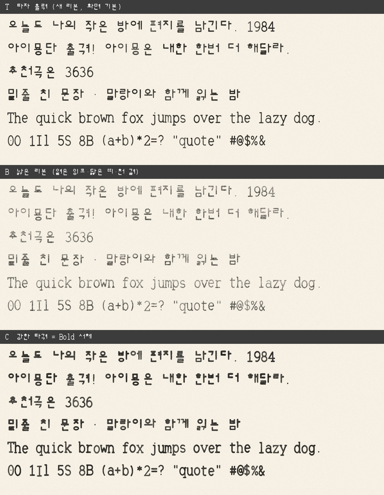

# 냄쿵타자기 (Naemkung Typewriter)

수동 공병우식 타자기에 반해 취미로 만든 완전 무료 한글·영문 고정폭 서체다. 누구나 무료로 쓸 수 있고, 상업용으로 써도 된다.

소개·직접 쳐 보기·내려받기: https://naemkung-company.github.io/naemkung-typewriter/



## 특징

- 한글은 세벌식 타자기처럼 탈네모꼴이다. 모든 글자의 윗선이 맞고, 아랫선은 모음·받침에 따라 들쭉날쭉하다
- 현대 한글 11,172자, 한글 호환 자모 51자, 영문·숫자·기호(ASCII 95자), 가운뎃점을 담았다
- 0 은 가운데 점, 1·I·l 은 모양을 달리해 헷갈리지 않게 했다
- 획은 활자 원도처럼 굵기에 차이가 있고, 끝은 잉크가 번진 듯 둥글다

## 글꼴 파일

| 파일 | 설명 |
|---|---|
| `fonts/NaemkungTypewriter-Regular.ttf` | 기본. 자모 위치와 가장자리가 조금씩 흔들려 타자로 찍은 느낌이 난다 |
| `fonts/NaemkungTypewriter-Bold.ttf` | 활자를 세게 친 굵은 판. 제목·강조에 쓴다 |
| `fonts/NaemkungTypewriter-Clean.ttf` | 흔들림 없이 매끄러운 판. 작은 글씨·화면 본문에 맞다 |

설치는 파일을 두 번 눌러 「설치」를 누르면 된다(macOS·Windows 공통). 웹에서는 `@font-face` 로 불러 쓴다.

```css
@font-face {
  font-family: "Naemkung Typewriter";
  src: url("NaemkungTypewriter-Regular.ttf") format("truetype");
  font-weight: 400;
}
@font-face {
  font-family: "Naemkung Typewriter";
  src: url("NaemkungTypewriter-Bold.ttf") format("truetype");
  font-weight: 700;
}
```

## 라이선스

[SIL Open Font License 1.1](OFL.txt)(OFL)로 공개한다.

| 할 수 있는 일 | 조건 |
|---|---|
| 개인·상업 용도로 자유롭게 사용(문서·인쇄물·영상·로고·웹·앱) | 없음. 만든 결과물에는 OFL 이 적용되지 않는다 |
| 앱·게임·웹사이트·제품에 글꼴 파일을 넣어 함께 배포 | 라이선스 문구(`OFL.txt`)를 함께 넣는다 |
| 고치거나 다른 글꼴과 합쳐 새 글꼴을 만들어 배포 | 새 글꼴도 OFL 로 공개한다 |
| 글꼴 파일만 따로 돈을 받고 판매 | 할 수 없다(다른 소프트웨어와 묶어 파는 것은 된다) |

자세한 내용은 [OFL FAQ](https://openfontlicense.org)를 본다.

저작권자는 냄쿵콤파니(Naemkung Company)다. 만든 방법, 이름, 권리 침해 신고 방법은 [NOTICE.md](NOTICE.md) 에 적었다.

다른 글꼴을 베끼지 않았다는 증거(재현 빌드, 기존 한글 글꼴 16종과의 모양 비교, 판별 기록)는 [PROVENANCE.md](PROVENANCE.md) 에 있다.

## 공병우 박사를 기리며

냄쿵타자기의 들쭉날쭉한 아랫선은 공병우 박사(1907~1995)의 세벌식 타자기에서 왔다. 공병우 박사는 우리나라 첫 안과 전문 의원을 연 안과 의사였고, 평생을 한글을 기계로 빠르고 바르게 쓰는 길을 여는 데 바쳤다.

그가 만든 세벌식 타자기는 초성·중성·종성을 따로 쳐서 한글을 네모 틀에 억지로 맞추지 않고 생긴 대로 찍어 냈다. 모양이 고르지 않다며 「빨랫줄 글꼴」이라는 놀림도 받았지만, 그 속도와 정확함이 한글 기계화의 바탕이 되었다. 눈을 고치던 의사는 앞을 보지 못하는 사람을 위한 점자 타자기를 만들었고, 여든을 앞둔 나이에 매킨토시로 컴퓨터 세벌식 한글을 일구었다.

세상을 떠나면서는 죽음을 알리지 말고 장례식도 치르지 말라고 했다. 쓸 만한 장기와 시신은 기증하고, 남은 재산은 앞을 보지 못하는 사람들을 위해 쓰라고 남겼다. 이 글꼴은 그 마음에 보내는 작은 감사 편지다.

| 연도 | 일 |
|---|---|
| 1907 | 평안북도 벽동군에서 태어남(1월 24일) |
| 1926 | 조선 의사 검정 시험 합격 |
| 1936 | 나고야 제국대학 의학박사 |
| 1938 | 공안과 개원 — 우리나라 첫 안과 전문 의원 |
| 1949 | 최초의 실용 세벌식 한글 타자기 개발, 국회의장상 |
| 1958 | 콘택트렌즈 첫 도입 시술, 한글 타자기 발명 공로로 대통령 표창 |
| 1959 | 한글학회 이사 |
| 1968 | 기계식 한영 겸용 타자기 발명 |
| 1971 | 기계식 한글 점자 타자기 개발 |
| 1974 | 외솔 문화상 |
| 1981 | 국민훈장 석류장 |
| 1980년대 | 세벌식 글자판을 미국 교포 사회에 보급, 매킨토시로 세벌식 글자꼴과 입력기 개발을 이끌고 젊은 개발자들을 도움 |
| 1987 | 제1회 서재필 상 |
| 1988 | 한글문화원 개설 |
| 1990 | 은관문화훈장 |
| 1995 | 3월 7일 세상을 떠남, 시신은 의학 교육에 기증. 금관문화훈장 추서 |

약력은 위키백과 「공병우」 문서를 따랐다. 태어난 해는 문서 안에 1906년으로 적힌 곳도 있다.

- [위키백과 — 공병우](https://ko.wikipedia.org/wiki/%EA%B3%B5%EB%B3%91%EC%9A%B0)
- [위키백과 — 세벌식 자판](https://ko.wikipedia.org/wiki/%EC%84%B8%EB%B2%8C%EC%8B%9D_%EC%9E%90%ED%8C%90)
- [위키백과 — 한글 타자기](https://ko.wikipedia.org/wiki/%ED%95%9C%EA%B8%80_%ED%83%80%EC%9E%90%EA%B8%B0)
- [국가기록원 — 한글 타자기 이야기](https://theme.archives.go.kr/next/koreaOfRecord/typewriter.do)

냄쿵타자기는 공병우 박사의 유족이나 관련 단체와 관계가 없고, 후원·승인을 받지 않았다.

## 연락

칭찬, 재미있는 제안, 이 글꼴로 만든 작품 자랑은 메일 [jaykafka12@gmail.com](mailto:jaykafka12@gmail.com) 로 보내 주기 바란다. 글자 모양 오류나 권리 관련 문제는 기록이 남도록 [GitHub Issues](https://github.com/naemkung-company/naemkung-typewriter/issues) 에 올려 주면 더 빨리 확인한다.

## 직접 만들기

이 서체는 다른 글꼴 파일이나 윤곽을 쓰지 않고 코드만으로 만든다. `source/build_font.py` 에 글자마다 획 중심선 좌표를 적어 두었고, 이 선에 굵기를 입혀 윤곽을 얻는다. 한글은 초성·중성·종성 부품을 한 벌씩 그린 뒤 11,172 음절을 부품 조합으로 만든다.

Python 3.11 이상과 `fontTools`, `Pillow`, `numpy` 가 필요하다.

```
cd source
python3 build_font.py            # build/NaemkungTypewriter-Regular.ttf
python3 build_font.py --clean    # build/NaemkungTypewriter-Clean.ttf
python3 build_font.py --bold     # build/NaemkungTypewriter-Bold.ttf
python3 preview.py build/NaemkungTypewriter-Regular.ttf sample.png   # 견본 그림
```

`preview.py` 의 견본은 글자마다 잉크 농도와 위치를 조금씩 바꾸고 종이 질감을 얹어 타자 출력처럼 그린다. T 는 새 리본, B 는 낡은 리본(옅은 잉크·닳은 띠·천 결), C 는 Bold 를 세게 친 모습이다. Bold 를 그리려면 Regular 와 같은 폴더에 Bold 파일이 있어야 한다.



## 판 기록

- 0.33 (2026-11-08) 첫 공개판

---

# Naemkung Typewriter

A completely free Korean/Latin monospaced typeface, made as a hobby out of love for manual Kong Byung-woo (Sebeolsik) Hangul typewriters. Hangul follows the Sebeolsik typewriter style (shared top line, ragged bottom). Regular, Bold and Clean styles. Covers all 11,172 modern Hangul syllables, 51 compatibility jamo, and ASCII.

Licensed under the [SIL Open Font License 1.1](OFL.txt): free for personal and commercial use, embedding, and modification. The font files alone may not be sold, and modified fonts must stay under the OFL.

Copyright 2026 Naemkung Company. Glyphs are generated from stroke definitions in `source/build_font.py`; no third-party font data is used. See [NOTICE.md](NOTICE.md).
